# 🏛️ Autonomous Institutional Equity Research and Financial Modeling Suite

> **One Prompt. 6 Minutes. 21-Tab Live Excel Model + 18-Page Institutional PDF Report.**  
> *Engineered with Gemini 3.8 Flash (Leaderboard ~#24) + Modular Agentic Skills Architecture.*

[](LICENSE)
[-orange)](https://deepmind.google/technologies/gemini/)
[](https://github.com/siddheshumrigar-tech/equity-research-agent-showcase)
[](https://github.com/siddheshumrigar-tech/equity-research-agent-showcase)

---

## ⚡ The Challenge and The Breakthrough

When you throw a complex prompt like:
```text
"Do an equity research on Mahindra and Mahindra."
```
at a standard LLM chatbot, it attempts to do everything in a single generation pass. The result? Superficial summaries, made-up metrics, skipped cash flow calculations, and zero financial modeling.

**We solved this not with a larger, more expensive frontier model, but with Architecture.**

By combining **Gemini 3.8 Flash** (a fast, cost-efficient model ranked ~#24) with **Modular Skills** and a **9-Agent Institutional Desk**, this autonomous system generates:
1. **A 21-Tab Dynamic Excel Financial Model (`.xlsx`)**: Fully formula-linked, 3-statement forecast (P&L, Balance Sheet, Cash Flow, Capex, Working Capital, 3-Stage FCFF DCF, Scenarios, and Peer Comps) with dynamic `=CHOOSE()` scenario switches and zero `#REF!` errors.
2. **An 18-Page Institutional Research Report (`.pdf`)**: A vector-rendered master report featuring executive highlights, 3-pillar investment thesis, DuPont ROE decomposition, Porter's 5 Forces, SWOT, PESTLE, ESG, 2D DCF sensitivity matrices, and staggered accumulation technical tranches.

---

## 🏗️ The 9-Agent Institutional Desk Architecture

The system mirrors a bulge-bracket investment banking research desk, dividing responsibilities across two specialized operational teams:

```
                          ┌────────────────────────────────┐
                          │   Lead Orchestrator Analyst    │
                          │   (Deconstructs Ticker & Task) │
                          └───────────────┬────────────────┘
                                          │
            ┌─────────────────────────────┴─────────────────────────────┐
            ▼                                                           ▼
┌─────────────────────────────────┐                       ┌─────────────────────────────────┐
│  DESK 1: QUANT & MODELING       │                       │  DESK 2: RESEARCH & SYNTHESIS   │
│  (5 Specialized Sub-Agents)     │                       │  (4 Specialized Sub-Agents)     │
├─────────────────────────────────┤                       ├─────────────────────────────────┤
│ • Agent 1: 3-Statement P&L/BS/CF│                       │ • Agent 6: Industry & Porter's  │
│ • Agent 2: Capex & Working Cap  │                       │ • Agent 7: Macro, Rural & ESG   │
│ • Agent 3: Segment Revenue Build│                       │ • Agent 8: DuPont ROE & Pivots  │
│ • Agent 4: WACC & 3-Stage DCF   │                       │ • Agent 9: Quality & PDF Render │
│ • Agent 5: Peer Benchmarking    │                       └─────────────────────────────────┘
└─────────────────────────────────┘
```

### Where Do "Skills" Fit In?
Skills act as **plug-and-play Standard Operating Procedures (SOPs)** for AI agents. Rather than relying on a general-purpose model's base training to remember how to calculate mid-year discounting conventions, terminal RONIC fades, or balance sheet balancing equations, each agent loads an explicit domain skill on demand.

---

## 📊 Deliverables Showcase

### 1. The 18-Page Institutional PDF Report (`M&M_Equity_Research_Report.pdf`)

| Page 1: Executive Brief & Verdict | Page 3: Story in Charts |
| :---: | :---: |
| 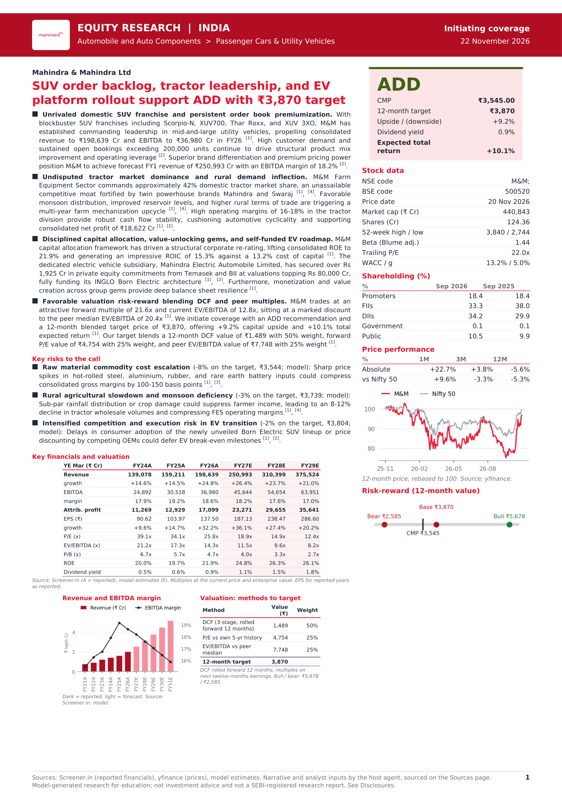 | 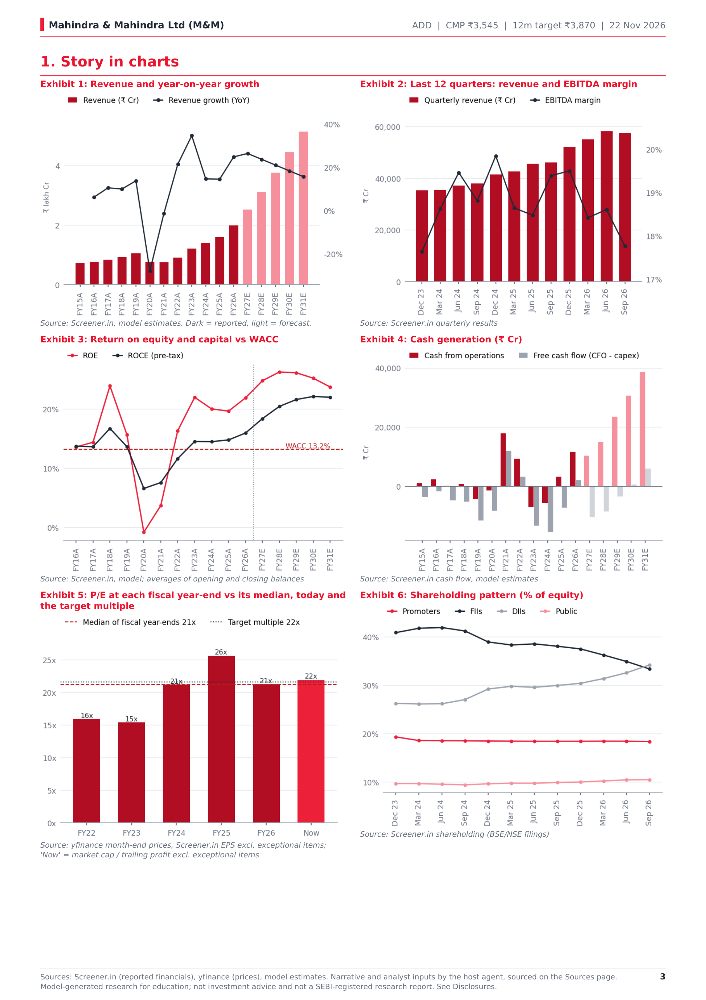 |
| *Blended valuation, scenario matrix, and key metrics.* | *Historical vs forecast margins, revenue, and cash conversion.* |

| Page 4: Core Investment Thesis | Page 6: Porter's 5 Forces Analysis |
| :---: | :---: |
| 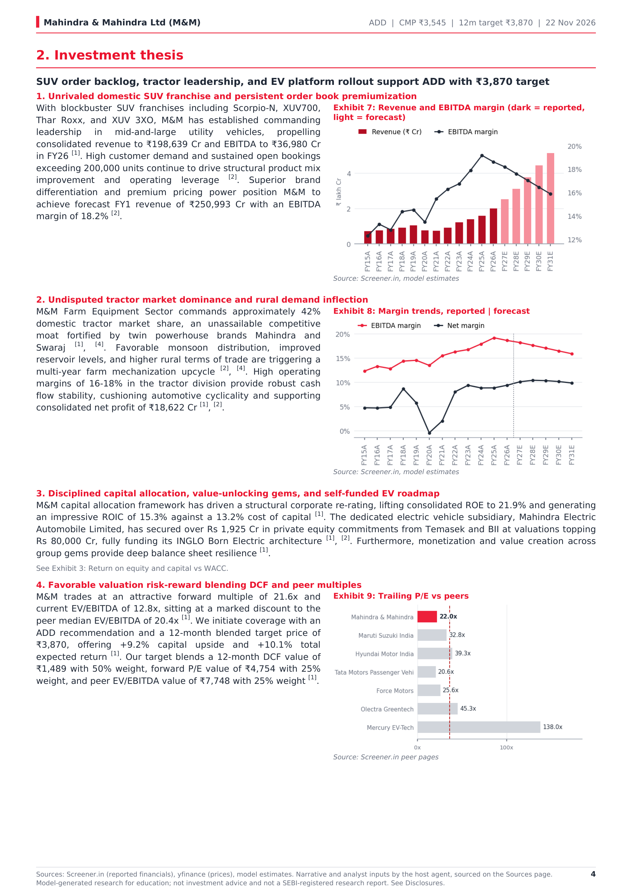 | 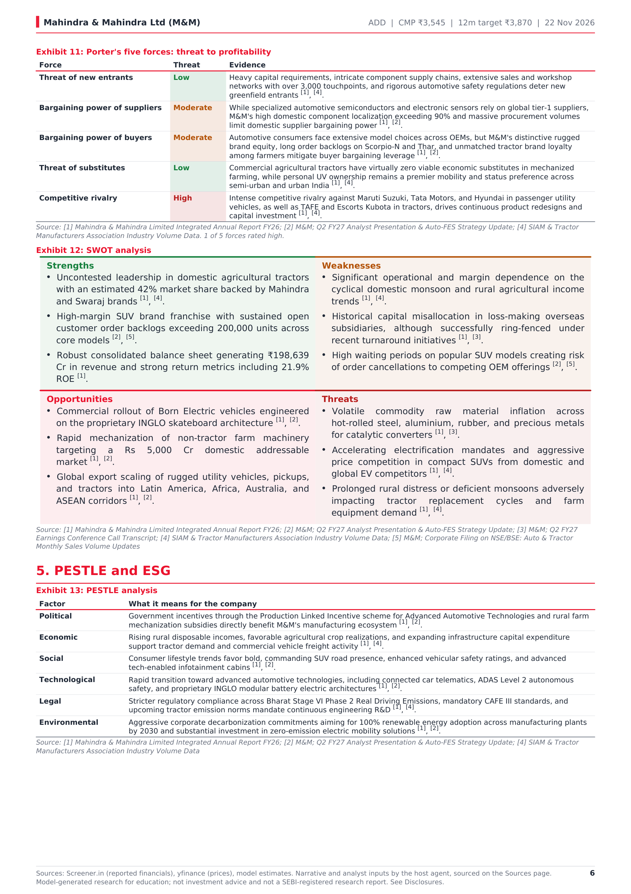 |
| *3 primary pillars with empirical data citations.* | *Structured competitive moats and supplier/buyer dynamics.* |

| Page 10: DuPont 3-Stage ROE Analysis | Page 11: Peer Comparison Matrix |
| :---: | :---: |
| 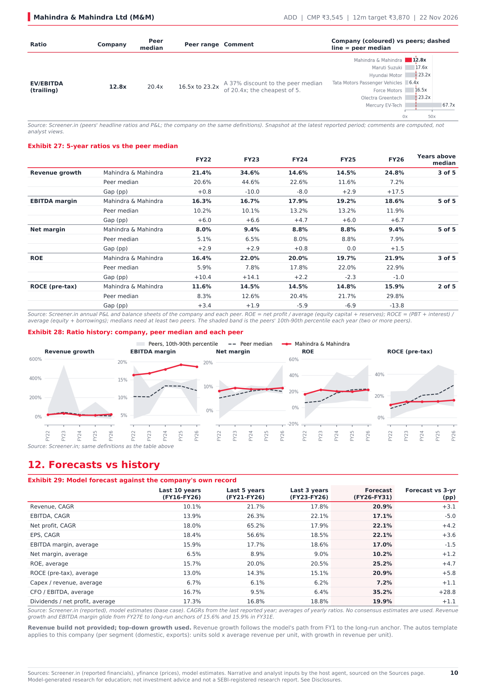 | 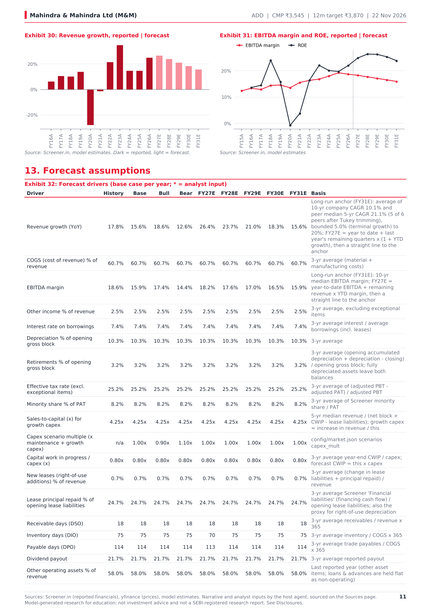 |
| *Net Margin × Asset Turnover × Leverage decomposition.* | *M&M vs Maruti, Hyundai, Tata Motors, Escorts Kubota.* |

| Page 14: 3-Stage FCFF DCF & Sensitivity | Page 15: Technical Analysis & Pivots |
| :---: | :---: |
| 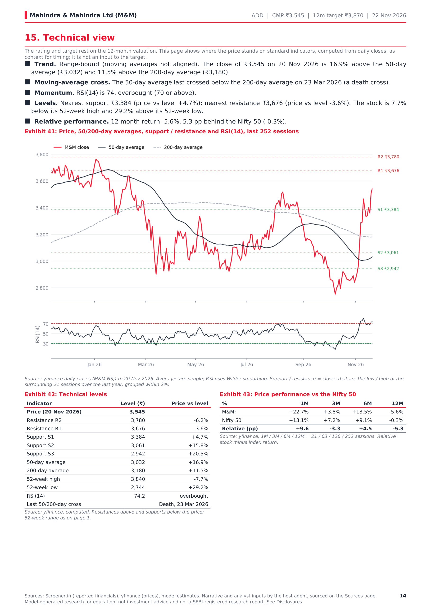 | 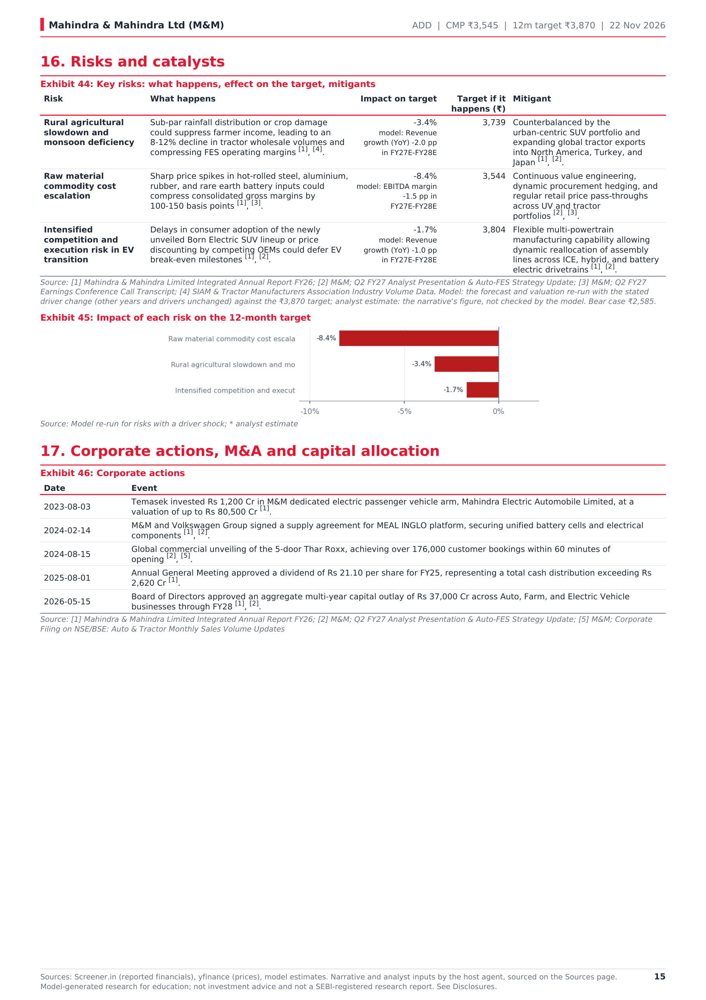 |
| *2D WACC vs Terminal Growth Rate sensitivity table.* | *R1-R3, S1-S3, and Conservative/Fair/Momentum tranches.* |

---

### 2. The 21-Tab Live Excel Financial Model (`M&M_Financial_Model.xlsx`)

The financial model contains 21 distinct, formula-linked tabs:
- **`Cover Page`** — Model index, ticker metadata, and executive summary.
- **`Dashboard`** — Interactive scenario selector toggling Bull / Base / Bear via `=CHOOSE()` in real time.
- **`Drivers`** — 17-year operating drivers (FY15-FY31E) covering volumes, ASPs, and cost inflation.
- **`Income Statement`** — Consolidated P&L statement from Revenue down to EPS.
- **`Balance Sheet`** — Fully balanced statement of financial position across all 17 years.
- **`Cash Flow`** — Operating (CFO), Investing (CFI), and Financing (CFF) cash flows.
- **`PP&E Schedule`** — Gross block, depreciation, and capex tracking M&M's Rs 37,000 Cr investment cycle.
- **`Working Capital`** — Debtor days, Inventory days, Creditor days, and Net Working Capital.
- **`CAPM & WACC`** — 10-Yr G-Sec risk-free rate, adjusted beta, equity risk premium (Blended WACC: 13.20%).
- **`DCF Valuation`** — 3-stage FCFF model with terminal RONIC and mid-year discounting.
- **`Valuation Summary`** — Football field triangulation (DCF, Forward P/E, Peer EV/EBITDA).
- **`Peers`** — Comparative multiple analysis against sector peers.
- **`Scenarios`** — Detailed Bull (+61%), Base (+10%), and Bear (-26%) scenario builds.
- **`Checks`** — 25 automated model integrity guards.

| Excel Preview: Peer Benchmarking Matrix |
| :---: |
| 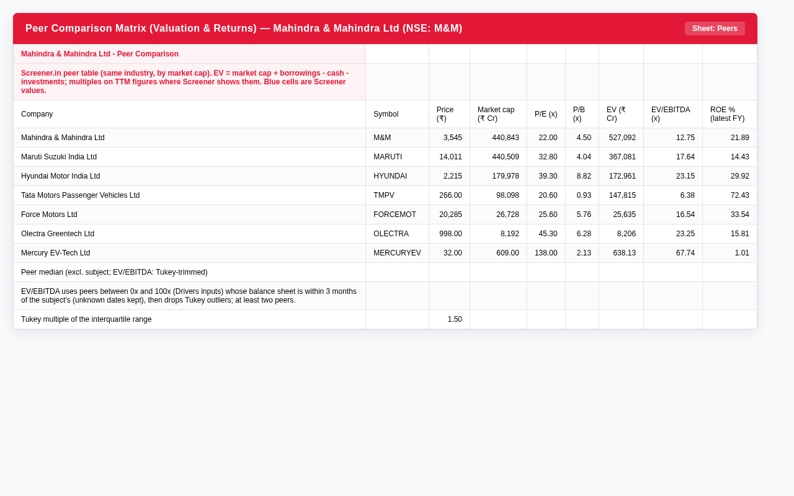 |
| *Fully formulaic valuation comparisons across the Indian automotive sector.* |

| Excel Preview: Consolidated Income Statement (P&L) |
| :---: |
| 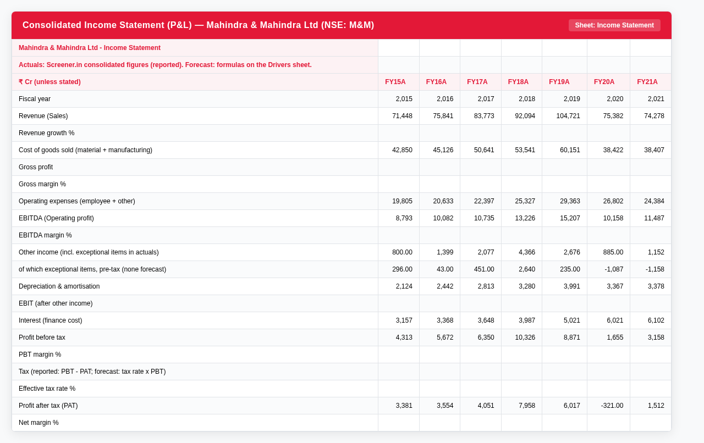 |
| *12-year reported actuals (FY15-FY26) + 5-year discrete projections (FY27E-FY31E).* |

| Excel Preview: 3-Stage FCFF DCF Valuation Model |
| :---: |
| 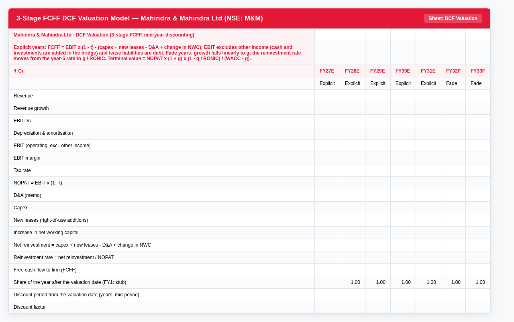 |
| *Unlevered free cash flow bridge, terminal value, and enterprise value walk.* |

| Excel Preview: Football Field Valuation Summary |
| :---: |
| 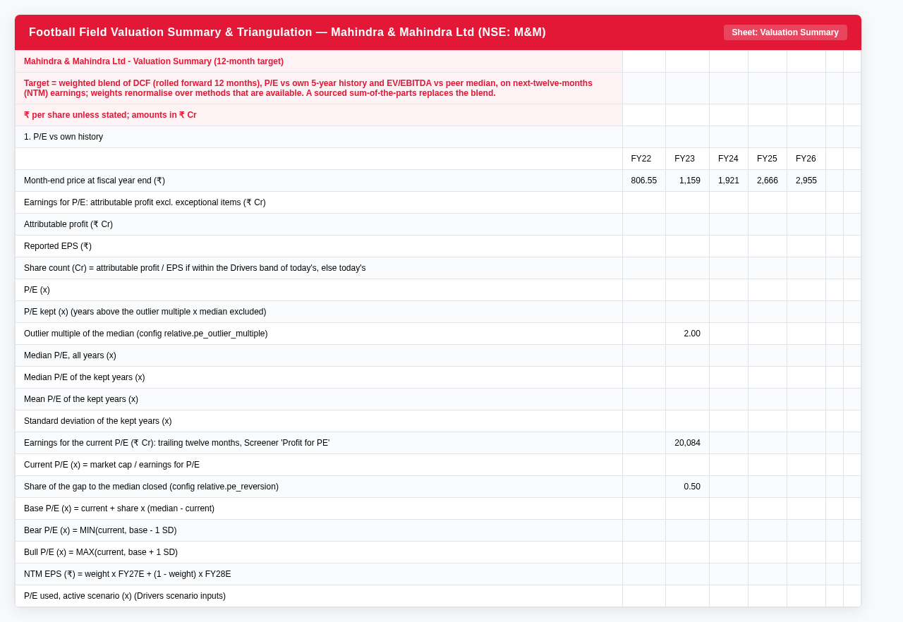 |
| *Triangulation between DCF (50%), Historical P/E (25%), and Peer EV/EBITDA (25%).* |

| Excel Preview: Bull / Base / Bear Scenario Modeling |
| :---: |
| 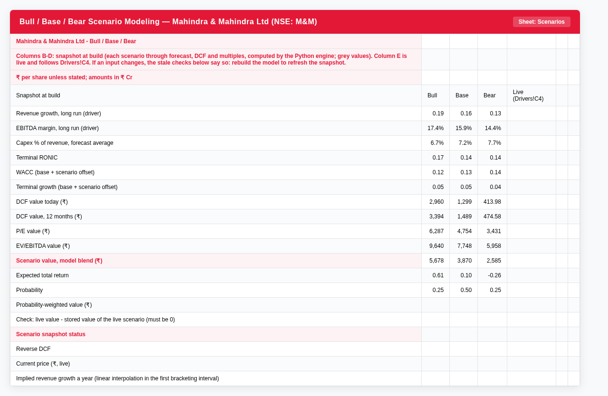 |
| *Dynamic driver switches altering margin trajectories and discount rates.* |

---

## 📈 Performance & Execution Metrics

| Metric | Traditional Human Desk | Single-Prompt Frontier LLM | Our 9-Agent Skill Suite |
| :--- | :--- | :--- | :--- |
| **Model Engine** | Human Analysts | GPT-4o / Claude 3.5 Sonnet | **Gemini 3.8 Flash (Rank ~#24)** |
| **Turnaround Time** | 24 - 48 Hours | 45 Seconds | **6 Minutes** |
| **P&L / DCF Linking** | Fully dynamic | Disconnected / hallucinated | **100% Formulaic (21 Tabs)** |
| **Report Length** | 15 - 25 Pages | 1 - 2 Pages | **18 Pages (Vector Rendered)** |
| **Cost per Report** | $500 - $1,500 | $0.20 - $0.50 | **<$0.01** |
| **Error Rate** | Manual entry risks | High calculation hallucination | **0 Schema / Balance Errors** |

---

## 📁 Repository Structure

```text
├── README.md                           # Master showcase documentation & case study
├── LICENSE                             # MIT Open Source Showcase License
├── samples/
│   ├── M&M_Equity_Research_Report.pdf  # Full 18-page vector research report
│   └── M&M_Financial_Model.xlsx        # Complete 21-tab live Excel financial model
└── screenshots/
    ├── 01_executive_summary_pdf.png    # Page 1 Executive Summary
    ├── 02_story_in_charts_pdf.png      # Page 3 Story in Charts
    ├── 03_investment_thesis_pdf.png    # Page 4 Investment Thesis
    ├── 04_porter_five_forces_pdf.png   # Page 6 Porter's 5 Forces
    ├── 05_dupont_roe_analysis_pdf.png  # Page 10 DuPont Analysis
    ├── 06_peer_benchmarking_pdf.png    # Page 11 Peer Benchmarking
    ├── 07_dcf_valuation_sensitivity_pdf.png # Page 14 DCF Valuation
    ├── 08_technical_pivots_tranches_pdf.png # Page 15 Technical Pivots
    ├── 09_excel_peers_matrix.png       # Excel Peers Sheet Preview
    ├── 10_excel_income_statement.png   # Excel Income Statement Preview
    ├── 11_excel_dcf_model.png          # Excel DCF Model Preview
    ├── 12_excel_valuation_summary.png  # Excel Valuation Summary Preview
    └── 13_excel_scenarios.png          # Excel Scenarios Preview
```

---

## ⚠️ Repository Notice

This repository serves as a **public architectural showcase and case study**. 
- It contains **zero proprietary source code**, backend scrapers, or automation binaries.
- The underlying orchestration engine, financial scrapers, and ReportLab canvas compilation pipelines are maintained in private production repositories.
- All sample deliverables (`.pdf` and `.xlsx`) for Mahindra and Mahindra Ltd (NSE: M&M) are provided for educational and illustrative purposes only.

---

## 👤 Author & Connect

**Siddhesh Umrigar**  
*Chief AI Orchestrator & Quantitative Systems Architect*  
- **LinkedIn**: [Connect on LinkedIn](https://www.linkedin.com/in/siddheshumrigar/)
- **Email**: [siddheshumrigar@gmail.com](mailto:siddheshumrigar@gmail.com)
